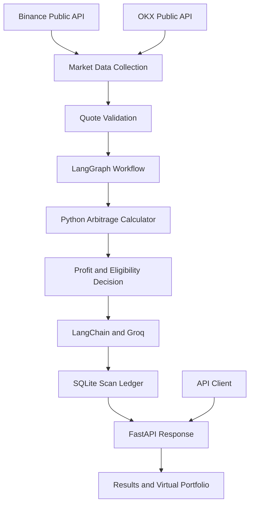

# NairaBTC-Agent

**An AI-powered cryptocurrency arbitrage analysis agent built with Python, LangGraph, LangChain, Groq, FastAPI, and SQLite.**

NairaBTC-Agent compares public BTC/USDT market quotes from Binance and OKX to identify potential cross-exchange arbitrage opportunities. It calculates estimated profitability after trading fees and slippage, uses an AI model to explain the results, and records scan outcomes in a SQLite database.

This project demonstrates the integration of deterministic financial calculations, AI-powered explanations, agentic workflows, REST API development, database persistence, security controls, and automated testing.

> **Important:** This project is for analysis and paper trading only. It does not place real cryptocurrency orders.

## Table of Contents

- [NairaBTC-Agent](#nairabtc-agent)
  - [Table of Contents](#table-of-contents)
  - [Project Overview](#project-overview)
  - [Features](#features)
  - [Architecture](#architecture)
    - [Design principle](#design-principle)
  - [How It Works](#how-it-works)
  - [Default Analysis Parameters](#default-analysis-parameters)
  - [Technology Stack](#technology-stack)
  - [Project Structure](#project-structure)
  - [Installation](#installation)
    - [Prerequisites](#prerequisites)
    - [1. Clone the repository](#1-clone-the-repository)
    - [2. Create a virtual environment](#2-create-a-virtual-environment)
    - [3. Install dependencies](#3-install-dependencies)
  - [Environment Configuration](#environment-configuration)
  - [Running the Application](#running-the-application)
    - [Run the standalone agent](#run-the-standalone-agent)
    - [Start the FastAPI server](#start-the-fastapi-server)
  - [API Endpoints](#api-endpoints)
    - [Run a scan](#run-a-scan)
    - [Retrieve scan history](#retrieve-scan-history)
    - [Retrieve the virtual portfolio](#retrieve-the-virtual-portfolio)
    - [Check service health](#check-service-health)
  - [Testing](#testing)
    - [Current Test Status](#current-test-status)
  - [Security](#security)
  - [Limitations](#limitations)
  - [Roadmap](#roadmap)
  - [Disclaimer](#disclaimer)

## Project Overview

Cryptocurrency prices can differ between exchanges. Arbitrage analysis examines whether buying an asset on one exchange and selling it on another could produce a positive return after transaction costs.

NairaBTC-Agent automates this analysis by retrieving public market quotes from Binance and OKX, evaluating potential buy and sell directions, calculating estimated net profit, and generating an AI-powered explanation of the results.

A key design principle is the separation of financial calculations from language-model output. **Python determines profitability and eligibility; the LLM explains the result.**

## Features

- **Market data integration:** Retrieves public BTC/USDT bid and ask prices from Binance and OKX.
- **Cross-exchange analysis:** Evaluates potential arbitrage in both exchange directions.
- **Cost-aware calculations:** Accounts for configured trading fees and estimated slippage.
- **Quote validation:** Checks quote freshness and validates important market-data inputs.
- **Agentic workflow:** Uses LangGraph to coordinate data collection, analysis, explanation, and persistence.
- **LLM integration:** Uses LangChain and Groq to explain calculated results.
- **Fallback handling:** Provides a rule-based explanation if the LLM is unavailable.
- **Database persistence:** Stores scan records and maintains a virtual paper-trading portfolio using SQLite.
- **REST API:** Uses FastAPI to expose scan, history, portfolio, and health endpoints.
- **API security:** Protects sensitive endpoints using API-key authentication.
- **Rate limiting:** Limits scan requests to five per minute.
- **Automated testing:** Includes tests for calculations, API behavior, workflow routing, failures, and paper-trading safeguards.

## Architecture



### Design principle

The Python arbitrage calculator is the authoritative source for profit calculations and eligibility decisions. The LLM receives these results and explains them in natural language; it does not independently authorize trades.

## How It Works

1. **Collect market quotes:** Retrieve public BTC/USDT quotes from Binance and OKX.
2. **Validate quotes:** Check that enough valid and sufficiently recent quotes are available.
3. **Analyze opportunities:** Evaluate both buy/sell directions using configured trading costs.
4. **Calculate net profit:** Account for estimated fees and slippage.
5. **Determine eligibility:** Compare calculated net profit with the minimum-profit threshold.
6. **Generate explanations:** Use Groq through LangChain to explain the results.
7. **Save scan records:** Store results in SQLite and report individual persistence failures.
8. **Return results:** Provide scan information through the FastAPI application.

## Default Analysis Parameters

| Parameter | Default |
|---|---:|
| Trading pair | BTC/USDT |
| Trade size | 0.001 BTC |
| Trading fee | 0.1% per side |
| Estimated slippage | 0.05% per side |
| Minimum net profit | 0 USDT |
| Maximum quote age | 30 seconds |
| Initial virtual balance | 1,000 USDT |

These are application defaults, not guarantees of actual market conditions. With a minimum net profit of zero, an opportunity must have strictly positive estimated net profit to be eligible.

## Technology Stack

| Technology | Purpose |
|---|---|
| Python | Application logic and calculations |
| FastAPI | REST API |
| LangGraph | Agent workflow orchestration |
| LangChain | LLM integration |
| Groq | AI-generated explanations |
| Pydantic | Data validation and configuration |
| SQLite | Scan history and virtual portfolio |
| pytest | Automated testing |
| Binance API | Public market quotes |
| OKX API | Public market quotes |

## Project Structure

```text
NairaBTC-Agent/
├── app/
│   ├── agent/
│   │   ├── graph.py
│   │   └── llm.py
│   ├── arbitrage/
│   │   └── calculator.py
│   ├── market_data/
│   │   ├── exchanges.py
│   │   └── models.py
│   ├── paper_trading/
│   │   └── ledger.py
│   └── main.py
├── tests/
│   ├── test_agent_graph.py
│   ├── test_api.py
│   ├── test_calculator.py
│   ├── test_llm_fallback.py
│   └── test_paper_trading.py
├── .env.example
├── .gitignore
├── requirements.txt
├── run_agent.py
└── README.md
```

This tree shows the main modules and tests; your repository may contain additional files.

## Installation

### Prerequisites

- Python 3.13 or a compatible Python version
- Git
- Internet access
- A Groq API key for LLM explanations

### 1. Clone the repository

Replace the placeholder with your actual GitHub repository URL.

```powershell
git clone <YOUR_GITHUB_REPOSITORY_URL>
cd NairaBTC-Agent
```

### 2. Create a virtual environment

```powershell
python -m venv .venv
```

Activate it in Windows PowerShell:

```powershell
.\.venv\Scripts\Activate.ps1
```

### 3. Install dependencies

```powershell
python -m pip install --upgrade pip
pip install -r requirements.txt
```

## Environment Configuration

Copy the example environment file:

```powershell
Copy-Item .env.example .env
```

Configure the variables required by your application:

| Variable | Purpose |
|---|---|
| `GROQ_API_KEY` | Authenticates requests to Groq |
| `GROQ_MODEL` | Specifies the Groq model |
| `API_SECRET_KEY` | Protects authenticated API endpoints |

Use the exact variable names expected by your `.env.example` and application settings. Generate a strong API secret and keep all credentials out of version control.

Never publish your `.env` file or expose your API keys in logs, screenshots, or public repositories.

## Running the Application

### Run the standalone agent

```powershell
python run_agent.py
```

### Start the FastAPI server

```powershell
uvicorn app.main:app --reload
```

The local API is normally available at:

`http://127.0.0.1:8000`

Interactive API documentation is available at:

`http://127.0.0.1:8000/docs`

These addresses are for local development; they are not public deployment URLs.

## API Endpoints

| Method | Endpoint | Authentication | Purpose |
|---|---|---|---|
| GET | `/` | Not required | Basic service information |
| GET | `/health` | Not required | Service and database health check |
| POST | `/scan` | Required | Run an arbitrage scan |
| GET | `/scans` | Required | Retrieve recent scan records |
| GET | `/portfolio` | Required | Retrieve the virtual portfolio |

Authenticated endpoints use the `X-API-Key` request header.

### Run a scan

Example using Windows PowerShell:

```powershell
$headers = @{
    "X-API-Key" = "YOUR_API_SECRET_KEY"
}

Invoke-RestMethod `
    -Uri "http://127.0.0.1:8000/scan" `
    -Method Post `
    -Headers $headers
```

Replace `YOUR_API_SECRET_KEY` with your configured API key.

### Retrieve scan history

```powershell
Invoke-RestMethod `
    -Uri "http://127.0.0.1:8000/scans" `
    -Method Get `
    -Headers $headers
```

### Retrieve the virtual portfolio

```powershell
Invoke-RestMethod `
    -Uri "http://127.0.0.1:8000/portfolio" `
    -Method Get `
    -Headers $headers
```

### Check service health

```powershell
Invoke-RestMethod `
    -Uri "http://127.0.0.1:8000/health" `
    -Method Get
```

The health endpoint checks database availability. It does not guarantee that external exchanges or the LLM provider are available.

## Testing

The project uses pytest for automated testing.

Run the complete test suite:

```powershell
python -m pytest -v
```

Run the agent workflow tests only:

```powershell
python -m pytest tests/test_agent_graph.py -v
```

### Current Test Status

**33 tests passed** in the latest reported full test run.

The test suite covers:

- Arbitrage calculation and validation
- Workflow routing and error handling
- LLM explanation fallback
- Partial database-save failures
- API authentication and rate limiting
- Database health checks
- Paper-trading safeguards

Passing tests demonstrates that the tested scenarios work; it does not guarantee production reliability or profitable trading outcomes.

## Security

The application includes several safeguards:

- API-key authentication for sensitive endpoints.
- Rate limiting on scan requests.
- Market-data validation before analysis.
- Deterministic Python calculations for financial decisions.
- LLM fallback behavior when explanations fail.
- Error handling for individual database writes.
- Paper trading instead of real exchange order execution.
- Environment variables for sensitive configuration.

The current rate limiter is in-memory. A multi-instance deployment may require a shared rate-limit backend.

## Limitations

- The application does not execute real cryptocurrency orders.
- Trading fees and slippage are estimates and may differ from actual execution costs.
- Prices can change between quote retrieval and hypothetical execution.
- Exchange API outages or network problems can interrupt scans.
- Groq availability and quotas can affect AI explanations.
- SQLite requires persistent storage in a deployment environment to preserve records across restarts.
- A successful local test suite does not establish that the application has been deployed to production.

## Roadmap

- [x] Integrate public Binance and OKX market data.
- [x] Implement deterministic arbitrage calculations.
- [x] Build the LangGraph agent workflow.
- [x] Integrate Groq using LangChain.
- [x] Implement SQLite scan persistence and virtual portfolio tracking.
- [x] Expose application features through FastAPI.
- [x] Add API-key authentication and rate limiting.
- [x] Expand the automated test suite to 33 passing tests.
- [ ] Complete and verify free-tier deployment.
- [ ] Configure persistent production storage and monitoring.
- [ ] Add an x402 payment layer after the core service is stable.

Items not marked complete remain planned work.

## Disclaimer

NairaBTC-Agent is an educational and portfolio project for AI engineering, software development, market-data processing, and arbitrage analysis. It is not financial advice and does not guarantee profits. Cryptocurrency trading involves substantial risk. Estimated arbitrage opportunities may not be executable or profitable after real-world costs.

---

**Built as an AI engineering portfolio project** demonstrating agentic workflows, LLM integration, deterministic financial logic, API development, automated testing, and responsible system design.
